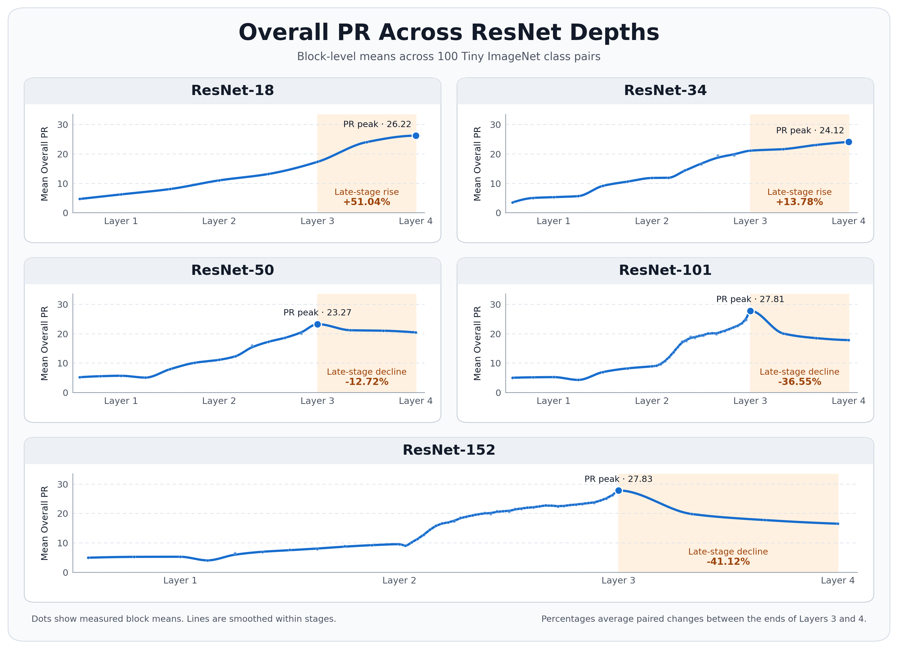
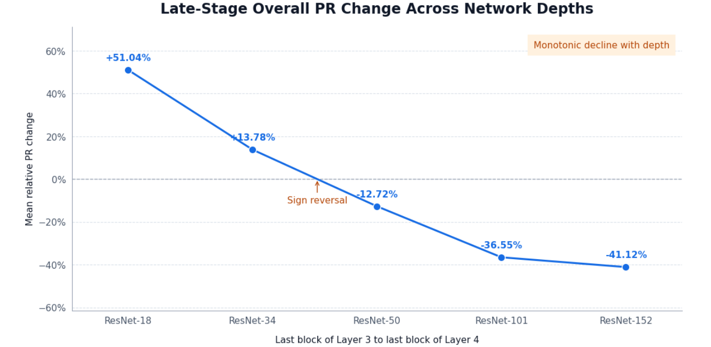

# Experiment 1 — Overall PR across 100 class pairs

## The question

If we send the same images through five pretrained ResNets, does the point cloud change in the same way near the end of each network? We can make this concrete by tracking Overall PR at every residual block and fixing one comparison in advance: the last block of Layer 3 versus the last block of Layer 4.

## Experimental setup

| Component | Setting |
| --- | --- |
| Models | ResNet-18, -34, -50, -101, and -152 with torchvision ImageNet-1K V1 weights, in evaluation mode |
| Images | Tiny ImageNet train split, pinned to revision `5a77092c28e51558c5586e9c5eb71a7e17a5e43f` |
| Class pairs | 100 distinct pairs from 20 classes: 10 animal classes and 10 object classes. The 100 pairs include 30 animal–animal, 40 animal–object, and 30 object–object pairs. Each class appears in 10 pairs. |
| Sampling | After auditing exact duplicates, draw 100 images per class without replacement within each pair. Pair selection and image sampling use seed `20261015`. |
| Forward passes | One 200-image batch per pair, for **100 forward passes per model**. All five models receive the same sampled images for each pair. |
| Readout | Full residual-block output, followed by global average pooling, per-image L2 normalization, joint centering, and Overall PR. The [repository README](../README.md) gives the calculation. |

For the first plot, we compute PR on each 200-image point cloud and average the 100 pair-level values at each block. For the second plot, we first compute the percentage change *within each pair*, then average those 100 percentages. If $P_{j,3}$ and $P_{j,4}$ are the PR values for pair $j$ at the last blocks of Layers 3 and 4, the reported statistic for each model is

```math
\overline{\Delta}_{3\to4} =
\frac{1}{100}\sum_{j=1}^{100}
100\frac{P_{j,4}-P_{j,3}}{P_{j,3}}\%.
```

The order matters here. Dividing the difference between the two block means by the Layer 3 mean would weight the pairs differently.

## Results



The first thing to look at is where each curve peaks. For ResNet-18 and ResNet-34, the highest measured mean PR is at the last block of Layer 4. For ResNet-50, ResNet-101, and ResNet-152, it is at the end of Layer 3. Each dot is a measured block mean. The blue lines are smoothed for display, and the peak labels and percentages use the measured values. The Layer labels mark the last block of each stage.



| Model | Peak block | Peak mean PR | Mean paired change from Layer 3 to Layer 4 |
| --- | --- | ---: | ---: |
| ResNet-18 | Layer 4, block 2 | 26.22 | +51.04% |
| ResNet-34 | Layer 4, block 3 | 24.12 | +13.78% |
| ResNet-50 | Layer 3, block 6 | 23.27 | −12.72% |
| ResNet-101 | Layer 3, block 23 | 27.81 | −36.55% |
| ResNet-152 | Layer 3, block 36 | 27.83 | −41.12% |

The mean change decreases in depth order across these five checkpoints and switches sign between ResNet-34 and ResNet-50. For the three deeper models, the mean relative change is negative. On average across pairs, variance is more concentrated at the end of Layer 4 by this PR measure.

The sign switch also coincides with a change from BasicBlock to Bottleneck. The three Bottleneck models still show an ordered decrease, but they also differ in where their extra blocks are placed. This comparison therefore establishes an association for the tested checkpoints. The class pairs share source classes and can reuse images across pairs, so the reported averages are descriptive for this design.

## Run the experiment

Open the [Notebook](ResNet_100_Pairs_Overall_PR.ipynb) in a Google Colab GPU runtime and select **Run all**. The notebook downloads the pinned dataset and weights and writes the sampled image manifest, the per-pair PR values, block means, late-stage changes, and plots to a new run folder. Set `SAVE_TO_DRIVE = False` to write to the Colab runtime instead of Google Drive.
